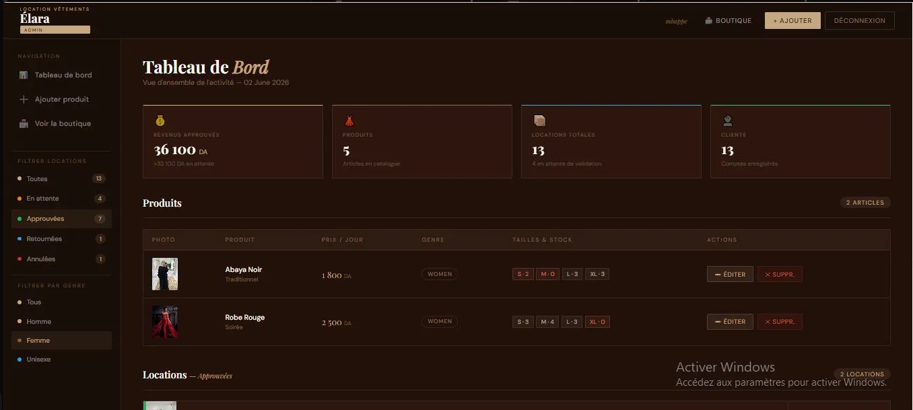
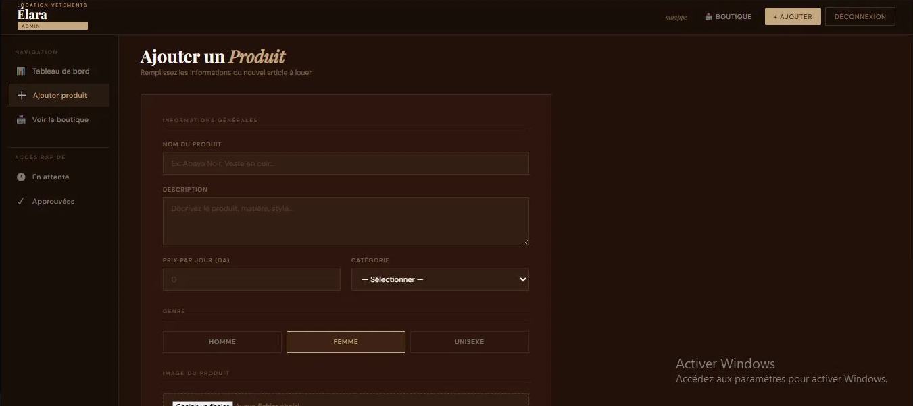
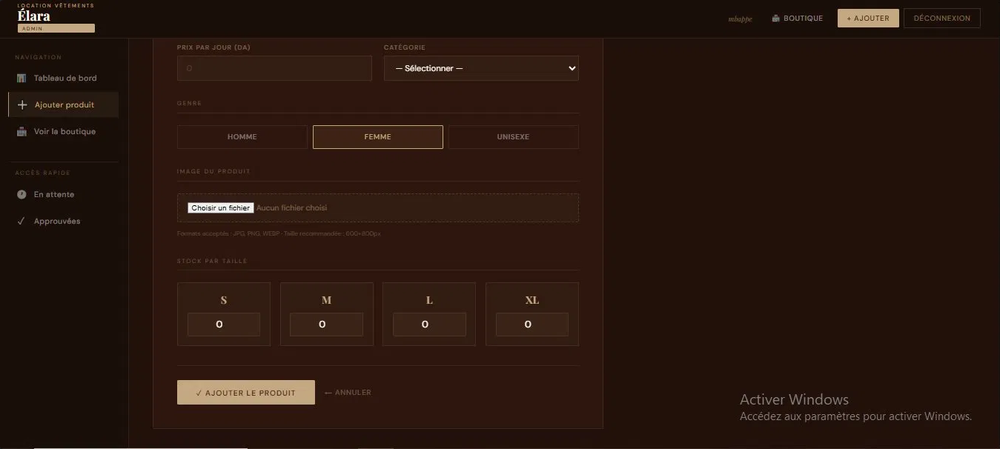
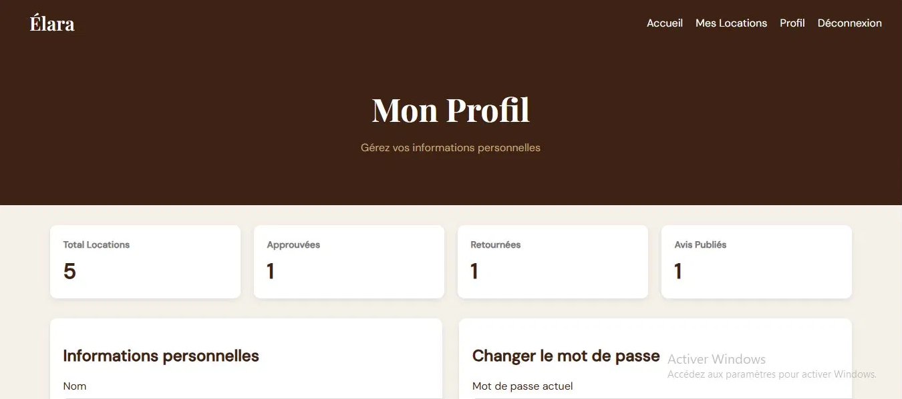
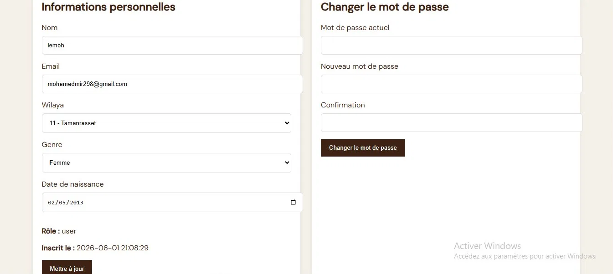
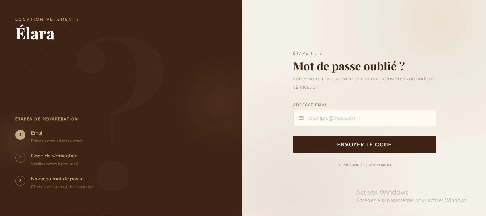
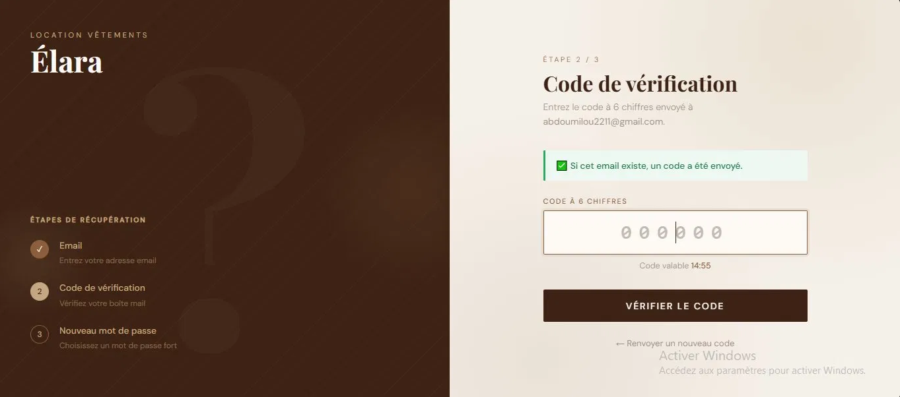
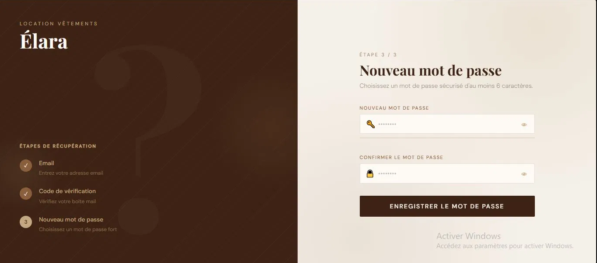
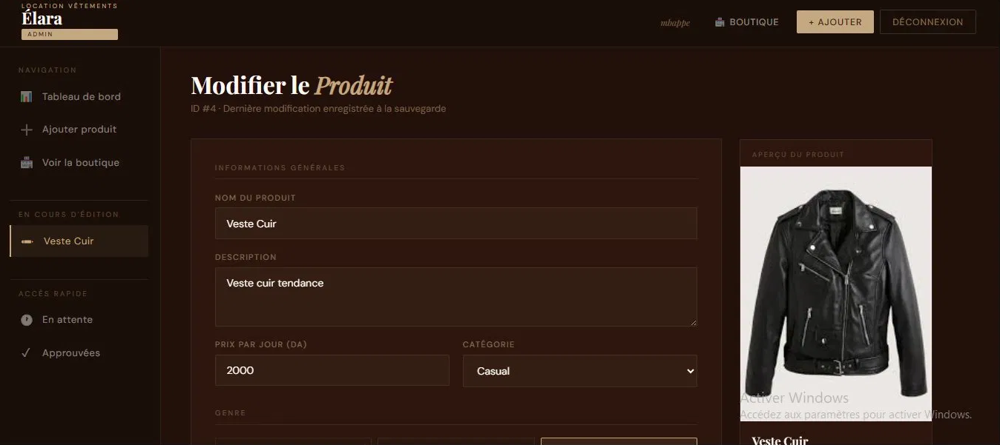
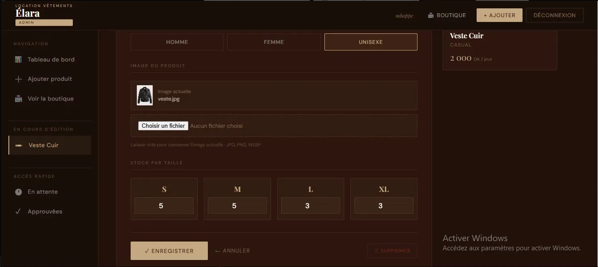

# Élara – Clothing Rental Platform

Élara is a web-based clothing rental platform developed as a Computer Science graduation project at Djillali Liabes University, Sidi Bel Abbès, Algeria.

## Screenshots

### Admin Dashboard

### Add Product

### Product Management

### User Profile

### Forgot Password

### Email Verification

### Reset Password

### Edit Product

### Product Stock Management

### Additional Interface

## Features

- Browse clothing products
- Search and filter products by category, gender and price
- View product details and available sizes
- Register and log in
- Submit and manage rental requests
- View personal rental history
- Admin dashboard for product and rental management
- Product stock and size management
- Password recovery through email verification with request throttling
- CSRF protection on authentication, rental, cart, review and admin actions
- Validated product image uploads with a 5 MB limit
- Archived products are hidden from the storefront while rental history is preserved
- Payment page does not collect card details until a real payment provider is integrated

## Technologies

- PHP
- MySQL / MariaDB
- HTML, CSS and JavaScript
- Bootstrap
- PHPMailer
- XAMPP

## Project Structure

- `index.php` – Product catalogue
- `product.php` – Product details
- `login.php` and `register.php` – Authentication
- `rent.php` and `my_rentals.php` – Rental workflow
- `dashboard.php` – Administration dashboard
- `location_vetement.sql` – Database schema
- `uploads/` – Product images
- `screenshots/` – Project screenshots
- `PHPmailer/` – Email functionality

## Local Setup

1. Install XAMPP and start Apache and MySQL.
2. Create a database named `location_vetement` in phpMyAdmin.
3. Import `location_vetement.sql`.
4. Select the `location_vetement` database and run `database_updates.sql` in phpMyAdmin. This adds the cart and password-reset tables and fields required by the current PHP code.
5. Copy `config.example.php` to `config.local.php`.
6. Update the database and SMTP settings in `config.local.php`.
7. Place the project folder inside XAMPP's `htdocs` directory.
8. Open `http://localhost/licence` in your browser. Adjust the folder name if needed.

## Security

- Keep `config.local.php` private.
- Never upload passwords, SMTP credentials or API keys.
- Use a dedicated database account in production.

## Academic Information

- Project: Élara
- Field: Computer Science
- University: Djillali Liabes University
- Location: Sidi Bel Abbès, Algeria
- Academic Year: 2025/2026

## License

This project is licensed under the MIT License.
